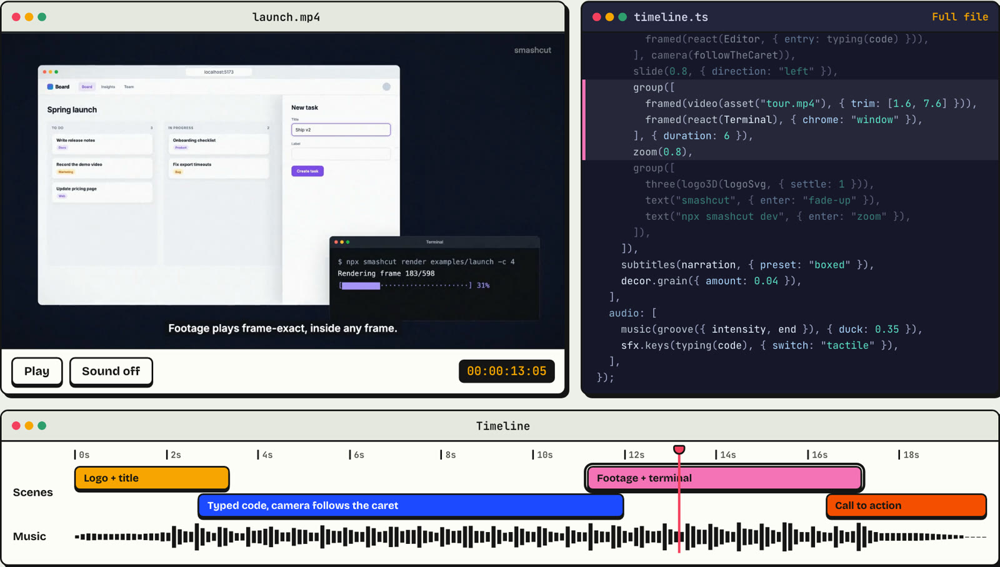
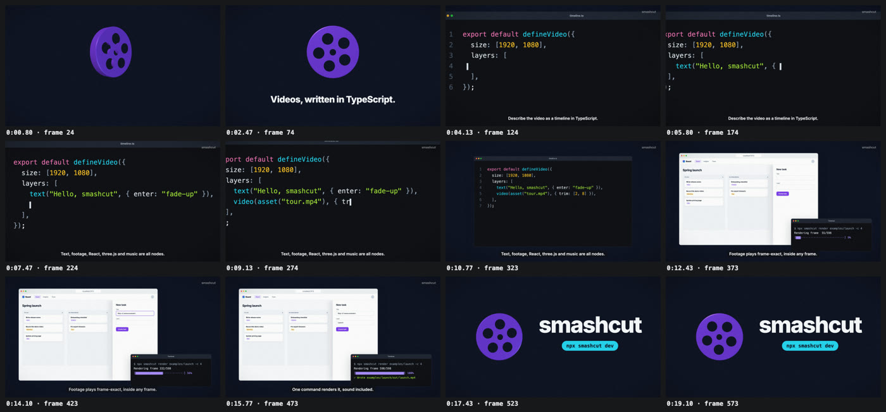
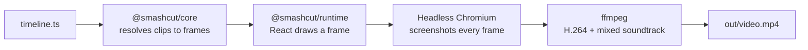

<p align="center">
  
</p>

<h1 align="center">smashcut</h1>

<p align="center">
  <strong>Videos, written in TypeScript.</strong><br />
  Describe every scene in one <code>timeline.ts</code>. Preview it live. Render a frame-exact MP4 with one command.
</p>

<p align="center">
  <a href="https://www.npmjs.com/package/smashcut"></a>
  <a href="https://github.com/volodymyrrudyi/smashcut/actions/workflows/ci.yml"></a>
  <a href="LICENSE"></a>
  <a href="https://getsmashcut.dev"></a>
</p>



<p align="center"><sub>The launch video in <a href="examples/launch"><code>examples/launch</code></a>, next to the code that made it. Try it on <a href="https://getsmashcut.dev">getsmashcut.dev</a>.</sub></p>

## Why smashcut

- **It's just code.** Scenes are functions, timing is arithmetic, and every change is a diff you can review.
  Reuse components across videos instead of copying layers between projects.
- **The same file, every time.** Every frame is a pure function of time, so renders are deterministic and run in
  parallel.
- **Batteries included.** Screen recordings, captions, typing with real keyboard sounds, camera moves, three.js
  and generated music. No sample libraries, no licensing.
- **Made for coding agents.** A built-in skill and two commands let Claude Code, Codex or Cursor write a video
  and check their own work.

## Quick start

You need Node 24+ and [ffmpeg](https://ffmpeg.org/download.html).

```sh
npx smashcut init my-video
cd my-video && npm install
npx playwright install chromium-headless-shell   # once per machine

npm run dev       # live preview with a timeline
npm run render    # → out/my-video.mp4
```

## A video, in code

```ts
import {
  asset, defineVideo, fade, groove, group, image, kf, music, react, series, sfx, solid, text,
} from "@smashcut/core";
import { Title } from "./lib/Title";

const INTRO = 3; // seconds
const T = 0.6; // transition length

export default defineVideo({
  size: [1920, 1080],
  fps: 30,
  layers: [
    series([
      group(
        [solid("#0f172a"), react(Title, { title: "Launch day", subtitle: "v2 is out" })],
        { duration: INTRO },
      ),
      fade(T),
      group(
        [
          image(asset("screenshot.png"), {
            width: 1200,
            y: -60,
            radius: 16,
            scale: kf([[0, 1], [4, 1.06]]),
          }),
          text("Ship faster", {
            position: "bottom",
            enter: "fade-up",
            style: { fontSize: 72, fontWeight: 800 },
          }),
        ],
        { duration: 4 },
      ),
    ]),
  ],
  audio: [
    music(groove({ seed: 1, key: "D major", intensity: 0.5 }), { fadeOut: 1.5, duck: 0.35 }),
    sfx.swoosh({ at: INTRO - T, length: 0.8 }),
  ],
});
```

Timing is in seconds. `series` plays scenes back to back and `fade(T)` overlaps them; `group` stacks layers.
Anything that moves takes a function of time, like `kf(...)` here or `(t) => …`.

## What goes on the timeline

| | Use | See |
|---|---|---|
| **Text and motion** | `text()`, enter/exit effects, transitions, `kf`, `spring`, seeded `rng` | [`motion`](examples/motion) |
| **React components** | `react(Component, props)`; components read the time with `useClip()` | [`hello`](examples/hello) |
| **Screen recordings** | `video()` with `trim`, `playbackRate`, `loop`, frame-exact | [`footage`](examples/footage) |
| **Browser, window and phone frames** | `framed()`, `pip()` | [`frames`](examples/frames) |
| **Typing and camera moves** | `typing()` with typos and keyboard sounds, `camera()`, `zoomTo()` | [`typing`](examples/typing) |
| **Captions** | `subtitles()` from SRT or WebVTT, four presets including word-by-word highlight | [`subtitles`](examples/subtitles) |
| **3D** | `three()` from `@smashcut/three` | [`three`](examples/three) |
| **Overlays** | `decor.vignette()`, `watermark()`, `border()`, `grain()` | [`decor`](examples/decor) |
| **Music and sound effects** | `groove()`, `ambient()`, `modern()`, `chiptune()`, `sfx.*`, ducking | [`launch`](examples/launch) |

The full API, with every option, is in the **[guide](docs/guide.md)**.

## Commands

Run them in a video folder as `npx smashcut <command> .` (or `npm run dev` / `still` / `render`).

| Command | What it does |
|---|---|
| `init <dir>` | Create a video folder: `timeline.ts`, a React component, `assets/`, editor and agent setup |
| `dev <dir>` | Live preview with a timeline of every clip, caption and sound. Press **N** to leave a review note |
| `render <dir>` | Render the MP4 with its soundtrack. `-c 4` parallel browsers, `--fps 60`, `--scale 2` for 4K, `--from` / `--to` frames |
| `still <dir> --frame N` | Render one frame as PNG |
| `sheet <dir>` | A contact sheet: 12 labelled frames in one PNG (`--count N`, `--every 0.5`) |
| `inspect <dir>` | Print every clip, caption and sound with its start and end (`--json` for scripts) |
| `audio <dir>` | Export just the soundtrack as WAV |

## Working with coding agents

Videos are code, so a coding agent can write them. `smashcut init` gives every video folder a
[skill](packages/cli/skills/smashcut/SKILL.md) (`.claude/skills/smashcut/`) and an `AGENTS.md` with the working
loop, the API and the rules that keep renders correct. Two commands let the agent check its own work without
watching a preview:

- `smashcut sheet` shows the whole video in one image, each frame labelled with its time;
- `smashcut inspect` lists every clip, caption and sound with its timing.



Notes you leave in the preview are saved to `.smashcut/notes.json` with what was on screen at that moment, so you
can just tell the agent to "fix the notes". In Claude Code you can also install the skill without a project:

```
/plugin install smashcut --marketplace volodymyrrudyi/smashcut
```

## Examples

Each folder in [`examples/`](examples) is a complete video. Copy the closest one to start.

| Example | What it shows |
|---|---|
| [`hello`](examples/hello) | The basics: `text`, `image`, `react`, `series` with `fade` / `slide` / `wipe`, `kf`, `modern()` music |
| [`motion`](examples/motion) | Every enter/exit effect and transition, easings, `spring`, seeded `rng` particles, `chiptune()` and a hand-written `pattern()` sting |
| [`frames`](examples/frames) | Every `framed()` chrome, phone viewports, `pip()`, a screenshot with a click call-out and `zoomTo()` |
| [`subtitles`](examples/subtitles) | SRT and VTT in all four presets, word timing, custom styles, an `ambient()` bed that ducks |
| [`typing`](examples/typing) | A form typed on four keyboard switches with a corrected typo, then a `camera()` that follows the fields |
| [`footage`](examples/footage) | A Playwright screen recording cut into scenes, one at 2× speed, a looping picture-in-picture |
| [`decor`](examples/decor) | `vignette`, `watermark`, `border` and `grain`, alone and together |
| [`three`](examples/three) | Lit geometry, an async texture, an SVG logo extruded in 3D, music that builds and releases. Try `--scale 2` |
| [`social`](examples/social) | A vertical 1080×1920 clip: scenes on the beat, word-highlight captions, a chart fetched from JSON. Try `--fps 60` |
| [`launch`](examples/launch) | A full launch video: 3D logo, code typed with the camera following, footage, captions, music with a real ending |

## How it works



| Package | Role |
|---|---|
| [`smashcut`](packages/cli) | The CLI: serves the video with Vite, drives headless Chromium with Playwright, encodes with ffmpeg |
| [`@smashcut/core`](packages/core) | The timeline model: builders, timing, animation, typing, captions and all audio synthesis |
| [`@smashcut/runtime`](packages/runtime) | The browser side: renders any frame with React and waits for fonts, images and `delayRender` |
| [`@smashcut/three`](packages/three) | Optional three.js clips |

Rendering is deterministic: `Date.now`, `performance.now` and `Math.random` follow the frame, footage is decoded
to exact frames ahead of time, and the frame range is split across parallel browsers. More in the
[guide](docs/guide.md#how-rendering-works).

## Contributing

```sh
npm install
npm run smashcut -- dev examples/hello      # preview an example
npm run smashcut -- sheet examples/hello    # check it at a glance
npm test && npm run typecheck
```

[`docs/plan.md`](docs/plan.md) tracks what's done and what's next, and [`docs/publishing.md`](docs/publishing.md)
covers releases.

## License

[MIT](LICENSE)
